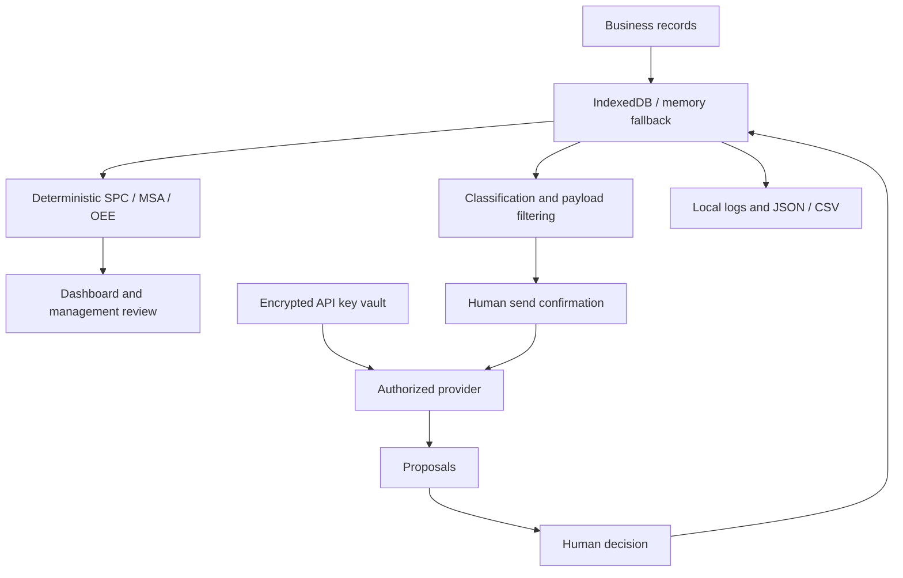

# Cockpit MECARIA — Studio Niko Design

**Local-first industrial quality cockpit with statistical process tools and human-governed AI proposals.**

Un cockpit de pilotage d'atelier d'usinage de précision : qualité, métrologie, production, amélioration continue et gouvernance des analyses IA.

    

**STUDIO NIKO DESIGN** · Build smart. Stay lightweight. Create without limits.

[English overview](#english-overview) · [Quickstart](#quickstart--démarrage-rapide) · [Issues](https://github.com/Nikoju1977/cockpit-mecaria/issues)

## Fiabilisation fonctionnelle — 25 novembre 2026

[Correctif des moteurs](https://github.com/Nikoju1977/cockpit-mecaria/commit/2ac451b1bf9e6a5a51ba88253b24a348211e0fbc) · [Gouvernance IA et indicateurs](https://github.com/Nikoju1977/cockpit-mecaria/commit/a39b35c9087901419a1058485a44a719310a7160).

- TRS : validation stricte des cinq entrées, quantités entières, cohérence des temps et de la cadence ; aucun TRS global si un relevé est invalide. Arrêt complet ou production nulle valides avec TRS nul ; ratios indéfinis non inventés. Agrégation pondérée par le temps de cycle.
- MSP : limites de spécification ordonnées, taille entière des sous-groupes, détection des étendues sous LCL, blocage de la capabilité si moins de 20 sous-groupes, signal de cause spéciale ou dispersion nulle. Ce seuil est une règle interne prudente, non une preuve de stabilité ou une exigence normative universelle.
- R&R : grille de dimensions exactes, tolérance positive si renseignée, valeurs finies, verdict prudent pour dispersion nulle, étendues anormales ou ndc insuffisant. Les constantes et la méthode moyennes-étendues ne sont pas requalifiées.
- IA : aucun envoi si SHA-256 indisponible ; retrait du repli non cryptographique. Les anciens historiques peuvent encore contenir des empreintes djb2.
- 22 assertions JavaScript ont réussi sur le TRS, son agrégation et la validation numérique. Les modifications MSP/R&R et IA ont été relues dans la source publiée, sans exécution de leurs parcours ni validation indépendante.

Les descriptions historiques ci-dessous peuvent mentionner des défauts désormais corrigés. Tests navigateur, calculs SPC/R&R indépendants, gouvernance IA en exécution, stockage métier, contrôle des accès, passerelles et déploiement restent à qualifier. Données fictives uniquement ; aucune certification ni libération industrielle.

## Qualification industrielle — cas de référence proposés

**Périmètre : aide au pilotage et démonstration, non système de libération de produit.** Les cas synthétiques suivants sont des attentes à vérifier indépendamment, et non des tests exécutés dans cette révision.

| Contrôle | Données / critère de référence |
| --- | --- |
| TRS nominal | Ouverture 480 min, arrêts 60 min, cycle 60 s, 400 pièces dont 380 bonnes : disponibilité 87,5 %, performance 95,24 %, qualité 95 %, TRS 79,17 % |
| TRS incohérent | Quantité bonne supérieure à la quantité produite, durée négative ou arrêts supérieurs à l'ouverture : rejeter ou signaler explicitement, ne pas publier un KPI trompeur |
| MSP | Vérifier I-MR et X-bar/R sur un jeu indépendant, avec constantes et tailles de sous-groupes documentées ; analyser la stabilité avant capabilité |
| R&R | Refuser une grille incomplète ; comparer EV, AV, GRR, PV, TV et ndc à un calcul indépendant de même méthode |
| Gouvernance IA | Vérifier désactivation, échéance de décision, exclusions et confirmation avec données fictives ; aucune donnée classifiée ou réelle |
| Intégrité | Une empreinte `djb2-` ne doit pas satisfaire un contrôle SHA-256 ; journal local et identité déclarative insuffisants pour une preuve d'audit |

Le code historique de TRS ne rejetait pas explicitement toutes les incohérences de quantité et de durée ; le correctif ci-dessus renforce cette validation. Les protections d'accès du navigateur ne remplacent pas les autorisations serveur. La qualification doit couvrir les unités, données manquantes, sauvegardes, identité, audit et validation humaine. Les références normatives existantes sont conservées sans nouvel examen de leur applicabilité.

**English:** Proposed synthetic checks cover OEE, SPC, gauge R&R, AI governance and record integrity. No tests were run. Invalid data must be rejected before KPI publication, and local roles, logs and hashes must not be treated as authenticated industrial evidence.

> **Prototype non qualifié.** Inspection statique du code uniquement : aucun nouveau test d'exécution, audit de sécurité, benchmark, test physique, validation industrielle ou clinique n'a été effectué pour cette révision. Utiliser des données synthétiques.

## Pourquoi ce projet ?

Relier les fiches métier, indicateurs et actions dans un seul espace de pilotage sans déploiement serveur obligatoire. Les calculs statistiques sont déterministes ; l'IA reste une option soumise à une décision d'activation et à une validation humaine. Cette séparation évite de confondre suggestions et décisions qualité.

## Fonctionnalités clés

- 📋 Registres qualité, non-conformités, audits, matrice exigences/preuves, SAV et actions.
- 📏 Gestion des moyens de mesure, échéances, MSP/SPC et R&R.
- 📊 Capabilité Cp/Cpk/Pp/Ppk, TRS et outils d'amélioration (Pareto, Ishikawa, AMDEC, 5S, PDCA, DMAIC).
- 🔗 Registres ERP et liaisons machines en lecture seule via passerelles à qualifier, pas de pilotage CNC démontré.
- 🔐 Coffre de clés chiffré, journal local, export CSV et sauvegarde/restauration JSON.
- 🧠 IA facultative : contrôles d'activation, exclusions de classification, aperçu de la charge envoyée, propositions soumises à décision humaine.

## Architecture & sécurité

### Moteurs déterministes inspectés

| Fonction | Méthode et limite |
| --- | --- |
| `spcCompute` | I-MR pour n=1 (étendue mobile / 1,128) ; X-bar/R pour n=2–10 (constantes A2, D3, D4, d2). Signaux de dérive, hors limites et étendues ; pas de qualification statistique indépendante. |
| Capabilité | Cp = (USL − LSL)/(6 sigma) ; Cpk par distance minimale aux limites / (3 sigma). Pp/Ppk utilisent l'écart-type global d'échantillon. Une capabilité n'est interprétable qu'après validation de la stabilité, du modèle et du système de mesure. |
| `msaCompute` | Méthode moyennes-étendues : EV, AV, GRR, PV, TV, %R&R, %tolérance et ndc. Grille 2–3 opérateurs, 2–10 pièces, 2–3 essais. Pas de modèle ANOVA. |
| `oeeCalc` | TRS = disponibilité × performance × qualité à partir du temps d'ouverture, arrêts, cycle et quantités. Vérifier unités, cohérence des données et ratios aberrants avant interprétation. |

### Sécurité et traçabilité

- Le rôle est déclaratif, pas une authentification. IndexedDB stocke les fiches en clair avec repli mémoire ; sauvegardes JSON en clair. Le journal local est modifiable et tronqué à 2 000 entrées ; les analyses IA à 200. Ni WORM ni journal immuable.
- Le coffre de clés utilise Web Crypto, AES-GCM 256 bits, PBKDF2-SHA-256 (310 000 itérations), sel et IV. Les clés sont déchiffrées en mémoire après ouverture du coffre ; le mécanisme ne chiffre pas les données métier et ne protège pas contre un script hostile exécuté dans la page.
- `sha256` calcule l'empreinte des messages IA, et le correctif bloque désormais l'envoi en cas d'échec Web Crypto ; les anciens historiques peuvent contenir un préfixe `djb2-`. Ce repli ne doit jamais être traité comme une preuve SHA-256 ou une signature.
- `aiGate`, `buildPayload` et `confirmSend` contrôlent l'activation et le réexamen, excluent certaines classifications, pseudonymisent selon réglage et affichent la charge envoyée avant confirmation. Pseudonymisation ≠ anonymisation ; le texte libre peut contenir des secrets. Les fournisseurs externes reçoivent des données si l'utilisateur confirme. Ne pas utiliser de données clients, défense, export contrôlé ou personnelles réelles dans ce prototype sans qualification et autorisation.
- Le code permet d'enregistrer une décision humaine sur les propositions ; le décideur est déclaré, non authentifié. Les passerelles ERP/CNC et la production réseau ne sont pas validées. Google Fonts est une ressource externe ; aucune dépendance à installer pour l'interface ne signifie pas zéro réseau.

## Référentiels et limites de conformité

| Cadre | Fonction visée, non preuve de conformité |
| --- | --- |
| ISO 9001, EN 9100 | Matrice exigences/preuves, NC, revue de direction, actions et traçabilité à qualifier. |
| [ISO 10012:2026](https://www.iso.org/standard/10012) | Management de la mesure et moyens de contrôle. |
| ISO/IEC 27001, ISO/IEC 42001 | Gouvernance de la sécurité et de l'IA ; contrôle organisationnel à démontrer. |
| RGPD, AI Act, contrôle des exportations | Applicabilité, minimisation, sous-traitance, analyse des risques et autorisations à qualifier. |

Aucune certification ISO, conformité réglementaire ou audit indépendant n'est revendiqué. Les méthodes R&R et MSP doivent être validées sur des cas de référence et les exigences des clients avant usage industriel.

## Quickstart / Démarrage rapide

Lancer `python3 -m http.server 8000` à la racine, ouvrir http://localhost:8000/ ; utiliser un contexte sécurisé pour le coffre Web Crypto. Démarrer avec des fiches fictives, tester les calculs et exporter une sauvegarde JSON. Laisser l'IA désactivée pendant les premiers essais. Ne pas renseigner de secrets ou d'informations industrielles réelles dans un dépôt public.

## Documentation technique historique

Les informations antérieures ci-dessous sont conservées pour le contexte ; les constats de l'inspection statique et les limites explicites ci-dessus priment sur toute formulation historique trop générale.

Cockpit de direction de site pour un atelier d'usinage de précision : qualité, métrologie, production, flux, SAV, amélioration continue et IA gouvernée. Application web en un seul fichier (`index.html`), sans serveur ni dépendance à installer.

## Modules

- **Pilotage** : tableau de bord, revue de direction (ISO 9001 § 9.3.2), agents de contrôle, fil d'affaire.
- **Qualité** : matrice exigences/preuves, NC, audits, métrologie (échéances d'étalonnage), SAV et 8D.
- **Amélioration** : les 7 outils de base (feuille de relevé, histogramme, Pareto, Ishikawa 6M, dispersion, cartes de contrôle, stratification), QQOQCP et 5 Pourquoi, MSP et capabilité (Cp, Cpk, Pp, Ppk), étude R&R (AIAG), AMDEC, TRS, 5S, PDCA, DMAIC.
- **Flux** : commercial, industrialisation, méthodes, production, logistique.
- **Système** : ERP, machines connectées (lecture seule), gouvernance IA, journal.

## Données

- Stockées dans le navigateur (IndexedDB), **non chiffrées** et non partagées entre postes.
- Export et import JSON pour les sauvegardes ; export CSV par registre.
- Le rôle est déclaratif : ce n'est pas une authentification.

## IA gouvernée

- Désactivée par défaut ; activation par décision enregistrée de la direction, avec date de réexamen.
- Fournisseurs autorisés par l'entreprise (Mistral, Groq, Cerebras) ; clés chiffrées AES-256-GCM dans le navigateur, jamais exportées.
- Pseudonymisation, exclusion des fiches « IA interdite » et « Défense / export contrôlé », validation humaine obligatoire, registre des traitements.
- Exigences applicables à qualifier : AI Act, RGPD, ISO 9001, EN 9100, ISO/IEC 27001 et 42001, contrôle des exportations.

## Limites

L'application ne vaut pas preuve de conformité sans validation par le système qualité. Avant un usage multi-utilisateur : serveur, authentification, chiffrement et sauvegardes.

---
Studio Niko Design

## Roadmap & contribution

Propositions non terminées :

- [ ] Valider MSP, capabilité, R&R et TRS sur des jeux de référence indépendants, y compris cas limites.
- [ ] Remplacer les rôles déclaratifs par une authentification et des autorisations serveur ; protéger données et journal.
- [ ] Refuser toute empreinte de secours non cryptographique lorsqu'une preuve d'intégrité est exigée.
- [ ] Tester les exclusions de données et les confirmations IA ; qualifier les fournisseurs et les passerelles en environnement contrôlé.

**Première contribution / `good first issue` (label proposé, non créé ici) :** Proposer un jeu de mesures synthétiques SPC ou R&R avec résultats attendus et unités documentées. Les rapports reproductibles sont bienvenus dans les [issues](https://github.com/Nikoju1977/cockpit-mecaria/issues). Ne publier aucune donnée personnelle, industrielle, médicale ou confidentielle. Toute modification ou redistribution reste soumise aux droits existants.

## English overview

Cockpit MECARIA is a local-first industrial management prototype with quality records, measurement equipment, deterministic SPC/capability, average-range gauge R&R and OEE. Optional AI analysis is gated by a recorded decision and human confirmation. API keys are encrypted in a local AES-GCM/PBKDF2 vault, but business records and exports are not encrypted. Roles are declarative, logs are editable and bounded, and SHA-256 has a non-cryptographic fallback. No certification, industrial deployment or independent validation is claimed. Run the full HTML over localhost with synthetic data.

No new runtime, security, clinical or industrial validation was performed during this documentation update. Feedback is welcome within the existing rights framework.

## Licence & auteur / License & author

**© 2026 Studio Niko Design — [Nikoju1977](https://github.com/Nikoju1977).** [Notice de droits / Copyright notice](LICENSE.md) : tous droits réservés pour les contributions originales concernées ; l'accès public au code ne constitue pas une licence open source. Les composants tiers conservent leurs licences propres. Aucun fichier de licence n'a été modifié.

## Qualification des moteurs qualité — 25 novembre 2026

[Correctif des moteurs](https://github.com/Nikoju1977/cockpit-mecaria/commit/a07a9fbe7dbe497ac952f9c93d0e00f133ef2f57) : refus des sous-dépassements non nuls lors de la lecture des nombres et des temps de production non représentables ; TRS borné pour les seuls écarts d'arrondi tolérés. Les cartes SPC utilisent le parseur numérique strict, la règle R4 examine les fenêtres de trois points et les indices non finis ne sont plus affichés. Les dimensions R&R utilisent la même validation numérique que le calcul ; le cache inclut le seuil R&R et les noms d'opérateurs. Seuil R&R interne accepté entre 0 et 30 %, sinon étude non évaluée.

[Tests des fonctions de production](tests/quality-motors.test.cjs) : exécution locale `node tests/quality-motors.test.cjs` depuis la racine, sans dépendance externe. Cas de référence TRS et agrégation pondérée par temps de cycle, cartes Xbar-R et I-MR, limites, Cp/Cpk/Pp/Ppk, méthode R&R moyennes-étendues, seuil modifié, données manquantes et dégénérées. [CI dédiée dans le workflow existant](https://github.com/Nikoju1977/cockpit-mecaria/actions/runs/45706271309) : résultat à vérifier. Ce test exerce les fonctions extraites de l'HTML, pas le DOM ni la persistance IndexedDB. Il ne démontre ni normalité, ni indépendance, ni représentativité des mesures, ni certification industrielle. Les règles et seuils doivent être approuvés pour chaque processus réel.
